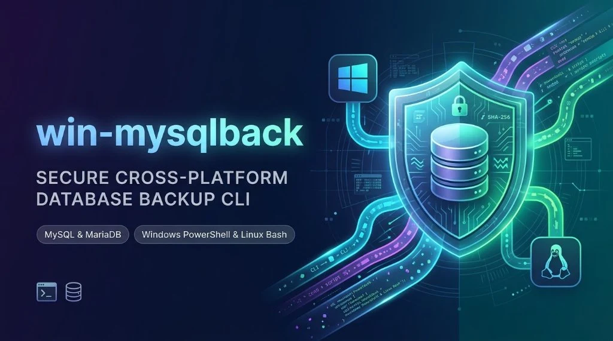

# win-mysqlback — CLI Multiplataforma de Respaldo MySQL/MariaDB (`v2.0.0`)



Una CLI moderna y multiplataforma en **Bash + Python 3** (`win-mysqlback.sh`) y **Windows PowerShell 5.1+/7+** nativo (`win-mysqlback.ps1`) para respaldos seguros de bases MySQL/MariaDB con compresión, hash SHA-256, retención y salidas `table` / `json` / `csv`.

## Modernización Histórica

Inspirado en **`win_mysqlback.bat`** (**HostGator Brasil**, autoría de **Percio Andrade — `percio.andrade@hostgator.com.br`**), escrito originalmente en Batch para servidores Windows Plesk.

En `v2.0.0`, fue modernizado en **Bash + Python 3** y **PowerShell nativo** eliminando la contraseña en texto plano (`set dbpass=...`), la exposición pública en `C:\inetpub\vhosts\default\htdocs\mysql\` y las pausas interactivas, añadiendo `--defaults-extra-file`, compresión y hashes SHA-256.

## Windows PowerShell

```powershell
pwsh -NoProfile -File .\win-mysqlback.ps1 -Databases app_db -DryRun -Output json
```

Validado E2E en `mcr.microsoft.com/powershell:alpine-3.20` y compatible con Windows PowerShell 5.1+.

## Ejemplo de Salida Real

```text
$ ./win-mysqlback.sh -d app_prod,analytics --exclude analytics --dry-run --no-color
=== win-mysqlback.sh v2.0.0 | MySQL/MariaDB Backup Report ===
DATABASE                 STATUS     SIZE_BYTES   FILE
----------------------------------------------------------------------------------
app_prod                 DRY_RUN    0            /var/backups/mysqlback/app_prod.sql.gz
```

## Licencia

Apache-2.0 — ver [LICENSE](LICENSE).
