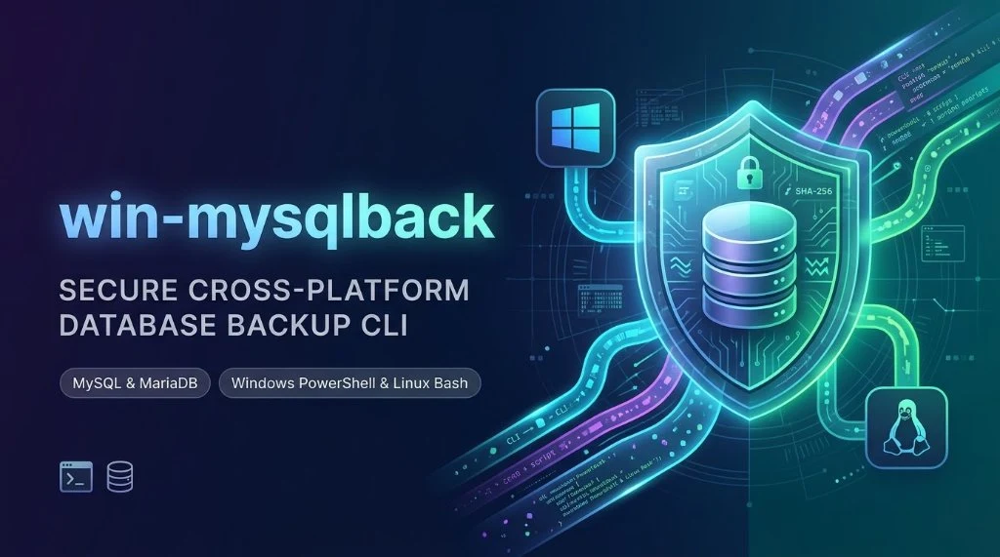

# win-mysqlback — CLI Cross-Platform de Backup MySQL/MariaDB (`v2.0.0`)



Uma CLI moderna e multiplataforma em **Bash + Python 3** (`win-mysqlback.sh`) e **Windows PowerShell 5.1+/7+** nativo (`win-mysqlback.ps1`) para backup seguro de bancos MySQL/MariaDB com compressão, hash SHA-256, retenção automática e saídas `table` / `json` / `csv`.

## Modernização Histórica

Inspirado no **`win_mysqlback.bat`** (**HostGator Brasil**, autoria de **Percio Andrade — `percio.andrade@hostgator.com.br`**), criado originalmente em Batch para servidores Windows com Plesk.

Na versão `v2.0.0`, foi reescrito para **Bash + Python 3** e **PowerShell nativo**, corrigindo falhas críticas de segurança e automação:
- **Remoção de Senha Hardcoded**: Elimina `set dbpass=...` e `--password=` na linha de comando, usando arquivos temporários `--defaults-extra-file` (`chmod 600`), variáveis `MYSQL_USER`/`MYSQL_PASSWORD` ou prompt seguro.
- **Fim da Exposição no Webroot Público**: Substitui `C:\inetpub\vhosts\default\htdocs\mysql\` (que expunha os dumps `.sql` via HTTP) por diretórios privados (`chmod 700`/`600` no Linux, `%ProgramData%\mysqlback\backups` no Windows).
- **Automação & Compressão**: Substitui `choice`/`pause` por `--databases`, `--exclude`, `--dry-run`, `--retain-days`, compressão `.sql.gz`/`.sql.zip` e checksum SHA-256.

## Windows PowerShell

```powershell
pwsh -NoProfile -File .\win-mysqlback.ps1 -Databases app_db -DryRun -Output json
```

Validado E2E no container `mcr.microsoft.com/powershell:alpine-3.20` e compatível com Windows PowerShell 5.1+.

## Exemplo de Saída Real

```text
$ ./win-mysqlback.sh -d app_prod,analytics --exclude analytics --dry-run --no-color
=== win-mysqlback.sh v2.0.0 | MySQL/MariaDB Backup Report ===
DATABASE                 STATUS     SIZE_BYTES   FILE
----------------------------------------------------------------------------------
app_prod                 DRY_RUN    0            /var/backups/mysqlback/app_prod.sql.gz
```

## Licença

Apache-2.0 — veja [LICENSE](LICENSE).
